<div align="center">

  <!-- AUTO DARK / LIGHT SWITCHING ANIMATED BANNER (ZENITSU THUNDER EDITION) -->
  <picture>
    <source media="(prefers-color-scheme: dark)" srcset="https://raw.githubusercontent.com/Vectorstudio11379/Vectorstudio11379/main/banner.svg?v=3">
    <source media="(prefers-color-scheme: light)" srcset="https://raw.githubusercontent.com/Vectorstudio11379/Vectorstudio11379/main/banner-light.svg?v=3">
    
  </picture>

  <br/><br/>

  <!-- SWINGING LANYARD ID BADGE -->
  <a href="https://github.com/Vectorstudio11379">
    
  </a>

  <br/>

  <!-- PROFILE VIEWS & STATUS BADGES -->
  <p align="center">
    
    
    
  </p>

  <!-- SOCIAL / CONNECT BUTTONS -->
  <p align="center">
    <a href="mailto:ezekielelijahkola@gmail.com">
      
    </a>
    <a href="https://timiportfolio.netlify.app" target="_blank">
      
    </a>
    <a href="https://elijah-ezekiel.onrender.com" target="_blank">
      
    </a>
    <a href="https://github.com/Vectorstudio11379">
      
    </a>
  </p>

</div>

---

### ⚡ About Me

```yaml
name: Elijah Ezekiel
title: Web Developer & AI Automation Engineer
focus: [Multi-Agent Systems, Autonomous Workflows, Modern Full-Stack Architecture]
education: Cyber Security (B.Sc Candidate @ Miva Open University)
venture: Founder @ Penithun Solutions
passions: [AI Agents, Clean Code, Scalable Systems, Piano, Anime]
tagline: "Turning ideas into intelligent systems & high-impact digital experiences."
```

- ⚡ **Thunderclap Speed:** Building autonomous agentic workflows and multi-agent integrations using **Gemini API**, **Python**, and **N8N**.
- 💻 **Full-Stack Web Architect:** Over 4 years of engineering high-conversion web platforms with **React**, **Next.js**, **JavaScript**, **Tailwind CSS**, and modern cloud infrastructure.
- 🛡️ **Cybersecurity Mindset:** Deep focus on data privacy, secure authentication, resilient systems, and cloud infrastructure.
- 🌍 **Global Reach:** Based in Abuja, Nigeria — actively collaborating on cutting-edge remote projects worldwide.

---

### 🛠️ Core Tech Stack & Toolkit

<div align="center">

| Domain | Technologies & Frameworks |
| :--- | :--- |
| **Languages & Core** |        |
| **Frontend & UI** |     |
| **AI & Automation** |    |
| **Platforms & CMS** |    |
| **DevOps & Security** |     |

</div>

---

### 📊 Performance & Local Analytics

<div align="center">

  
  &nbsp;
  

  <br><br>

  

</div>

---

### 🚀 Selected Projects

| Project | Description | Stack | Status |
| :--- | :--- | :--- | :---: |
| **[Penithun Solutions](https://github.com/Vectorstudio11379)** | Enterprise IT infrastructure, brand architecture, and cybersecurity management platform. | `React` `Tailwind` `Node.js` `Security` | 🟢 Active |
| **[Buildora AI Agency Engine](https://github.com/Vectorstudio11379)** | High-converting design and AI-driven automation framework delivering autonomous web systems. | `Python` `Gemini API` `React` `N8N` | 🟢 Live |
| **[ExpressTech Academy LMS](https://github.com/Vectorstudio11379)** | Comprehensive LMS integration with LearnPress, dynamic curriculums, and student progress flows. | `WordPress` `PHP` `LearnPress` `CSS3` | 🟢 Deployed |
| **[Southofheaven &amp; JumboDTG](https://github.com/Vectorstudio11379)** | High-performance e-commerce architecture revamp resulting in +40% speed and +25% conversions. | `Shopify` `Liquid` `JavaScript` `SEO` | 🟢 Completed |
| **[Beacon Corporate Realty](https://github.com/Vectorstudio11379)** | Full digital presence revamp with automated lead capture, interactive property showcases, and SEO. | `WordPress` `Elementor` `Analytics` | 🟢 Completed |

---

### 🐍 Contribution Activity & Snake Game

<!-- AUTO-GENERATED DAILY VIA GITHUB ACTIONS -->
<div align="center">
  <picture>
    <source media="(prefers-color-scheme: dark)" srcset="https://raw.githubusercontent.com/Vectorstudio11379/Vectorstudio11379/main/github-contribution-grid-snake-dark.svg?v=3">
    <source media="(prefers-color-scheme: light)" srcset="https://raw.githubusercontent.com/Vectorstudio11379/Vectorstudio11379/main/github-contribution-grid-snake.svg?v=3">
    
  </picture>
</div>

---

<div align="center">

  **⚡ "KEEP CODING • KEEP GROWING" ⚡**  
  *Designed with pure SVG animations, damped pendulum physics, and Zenitsu Thunder Breathing theme.*

  <br>

  [](mailto:ezekielelijahkola@gmail.com)
  &nbsp;
  [](https://timiportfolio.netlify.app)

</div>
